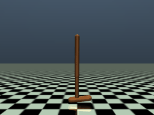
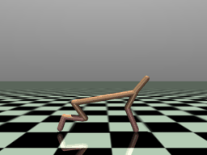
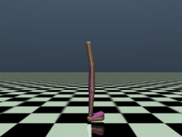
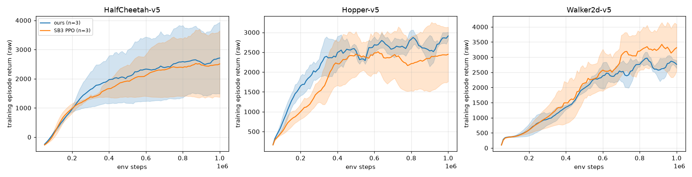
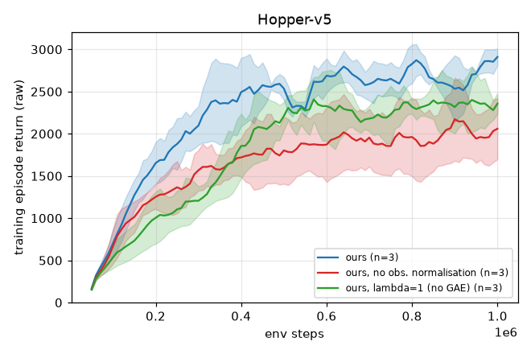

# ppo-mujoco-control

PPO written from scratch in PyTorch and numpy (no RL library for the agent) for continuous control on Gymnasium MuJoCo v5 tasks, measured against Stable-Baselines3 PPO under matched hyperparameters. Three environments, three seeds each, 1M environment steps per run, plus a two-part ablation on Hopper. Every number below comes from `results/eval.json`, `results/summary.md` and `logs/*.csv`.

| Hopper-v5 | HalfCheetah-v5 | Walker2d-v5 |
|---|---|---|
|  |  |  |

The clips show the seed-0 checkpoint of this repo's PPO, deterministic actions, rendered every 4th simulation step and capped at 200 frames (800 simulation steps, so HalfCheetah, a 1000-step episode, is cut short). I did not pick the best seed. MP4 versions are in `docs/`.

## Results

Final score: each trained policy is run deterministically (mean action) for 10 episodes on fresh environment seeds (`eval.py`); the per-seed mean of those 10 episodes is taken; the table gives mean and sample standard deviation (ddof=1) over the 3 seeds.

| Env | Ours (this repo) | SB3 PPO 2.9.0 |
|---|---|---|
| Hopper-v5 | 3395 +- 211 (3424, 3590, 3171) | 2933 +- 999 (3280, 3712, 1806) |
| HalfCheetah-v5 | 2994 +- 1540 (1762, 4721, 2498) | 2791 +- 1706 (4760, 1844, 1768) |
| Walker2d-v5 | 3827 +- 511 (4043, 3243, 4193) | 3231 +- 1889 (4414, 1053, 4227) |



Curves are the raw (unnormalised) returns of training episodes, averaged in a 50k-step window, mean and std over 3 seeds. They come from the stochastic training policy, so they sit below or above the deterministic final scores.

How to read this honestly: with 3 seeds the standard deviations are as large as the gaps between implementations, so I cannot claim either implementation is better. On every environment my mean is higher, but SB3's lower means come from one weak seed each on Hopper (1806) and Walker2d (1053, the 10 evaluation episodes there were 579-941 except one at 3846, i.e. a policy that mostly falls early), and on HalfCheetah both implementations have a 1.8k-to-4.7k spread across seeds. On Walker2d the SB3 training curve ends above mine (about 3300 against 2800), while the deterministic evaluation says the opposite; that reversal is another sign these differences are inside the noise. The sound conclusion is "same ballpark as SB3, with high seed variance", not "better".

Throughput was equal: about 2900 to 3400 env steps/s per run for both, 4.9 to 5.7 minutes per 1M steps, one process at a time.

## Ablation (Hopper-v5, 3 seeds, same seeds as the main runs)



| Variant | Final eval return | Per seed |
|---|---|---|
| Full (ours) | 3395 +- 211 | 3424, 3590, 3171 |
| No observation normalisation | 2602 +- 897 | 2123, 2045, 3636 |
| lambda = 1 (no GAE; advantage = Monte-Carlo return minus V) | 3359 +- 147 | 3377, 3204, 3495 |

Removing observation normalisation lowered the score in two of three seeds by about 1300 to 1400 and left the third unchanged, so it matters on Hopper but the effect is not uniform. lambda = 1 made no measurable difference to the final score in 3 seeds. I would not conclude GAE is useless: 1M steps, a 64x64 network, `gamma=0.99` and a short-horizon task like Hopper is a setting where the variance cost of Monte-Carlo returns is small, and I did not test sample efficiency early in training beyond looking at the curve.

## Implementation details (`ppo.py`, about 200 lines)

| Detail | Choice here | Note |
|---|---|---|
| Policy | Gaussian, mean from an MLP (64-64, tanh), state-independent learnable `log_std` initialised at 0 | Sampled actions are clipped to the action bounds only when stepping the env; stored actions and log-probs are unclipped |
| Critic | Separate 64-64 tanh MLP | No shared trunk |
| Init | Orthogonal: gain sqrt(2) hidden, 0.01 policy output, 1.0 value output, zero biases | Same scheme as SB3 |
| Advantages | GAE with lambda 0.95, gamma 0.99 (`compute_gae`) | Unit-tested against a hand-computed example |
| Time-limit truncation | On truncation (not termination) the reward gets `gamma * V(final_obs)` added | Gymnasium vector envs run with `SAME_STEP` autoreset to expose `final_obs`. Without this, a truncated Hopper/Walker2d episode would be treated as a failure |
| Observation normalisation | Running mean/std (`RunningMeanStd`, parallel-update formula), clipped to +-10 | Stats are frozen and saved in the checkpoint for evaluation. Ablated above |
| Reward scaling | Divide by the std of the running discounted return (no mean subtraction), clip +-10 | The reward-normalisation scheme used by VecNormalize and the Gymnasium wrapper; not ablated here |
| Advantage normalisation | Per minibatch | |
| Loss | Clipped surrogate (eps 0.2), value MSE coefficient 0.5, entropy coefficient 0 | Optional clipped value loss via `--clip-vloss`; off in all reported runs |
| Optimiser | Adam, lr 3e-4 annealed linearly to 0, eps 1e-5, grad-norm clip 0.5 | |
| Rollouts | 4 synchronous envs x 512 steps = 2048 per update, 10 epochs, minibatch 64 | 488 updates per 1M steps |

Matched baseline: SB3 `PPO("MlpPolicy")` with `VecNormalize` (obs and reward, clip 10) on 4 `DummyVecEnv` envs, and the same rollout size, epochs, minibatch, lr schedule, gamma, lambda, clip, coefficients and gradient clip as above. I did not use the rl-zoo tuned hyperparameters because I could not verify them offline. The two implementations are therefore close to the same algorithm with the same settings, which is why similar scores are the expected outcome. The comparison tests that the from-scratch code is correct, not that it improves on SB3.

## Reproduce

```bash
python3 -m venv --system-site-packages .venv && .venv/bin/pip install -r requirements.txt
pytest -q tests                                   # 4 tests, under 1 s: GAE and running normaliser
python train.py --env Hopper-v5 --seed 0          # ours, 1M steps, about 5 min on CPU (1 thread)
python train.py --env Hopper-v5 --seed 0 --impl sb3
python train.py --env Hopper-v5 --seed 0 --tag noobsnorm --no-obs-norm   # ablations: --tag nogae --no-gae
./run_all.sh                                      # the whole grid, sequential, about 2 hours
python eval.py                                    # 10 deterministic episodes per checkpoint -> results/eval.json
python plot.py                                    # -> results/curves.png, ablation_hopper.png, summary.md
python make_demo.py                               # -> docs/*.gif, *.mp4 (MUJOCO_GL=egl, needs ffmpeg)
```

Versions used: torch 2.11.0 (CPU), gymnasium 1.3.0, mujoco 3.17.0, stable-baselines3 2.9.0, numpy 2.3.5, Python 3.12. Training used one CPU thread per process (tiny networks; a 4-thread test was not faster, and I did not time it in detail). Runs are seeded but I have not checked bit-for-bit reproducibility across machines.

## Files

| File | Role |
|---|---|
| `ppo.py` | The agent: normaliser, GAE, actor-critic, training loop |
| `train.py` | One run, either implementation; writes `logs/<run>.csv` (episode return and length per finished training episode), `logs/<run>.time.json`, `ckpt/<run>.pt` or `.zip` |
| `eval.py`, `plot.py`, `make_demo.py`, `run_all.sh` | Evaluation, figures and tables, rendering, the grid |
| `tests/test_ppo.py` | GAE against a hand-computed example, done-flag cutting, lambda=1 equals MC return, running normaliser vs numpy |
| `logs/`, `ckpt/` | All 24 runs' logs and final checkpoints (2.3 MB checkpoints) |

## Limitations and what was not done

- 3 seeds per cell, and the seed variance is large; no significance test was run and none would pass on most rows. This is not enough to rank the two implementations.
- Ant-v5 (optional in the plan) was not run. Nothing was cut otherwise: all 3 environments, 3 seeds, 1M steps, both implementations.
- Curves use training-episode returns, not periodic deterministic evaluation, to avoid extra compute. Only the final checkpoint is evaluated deterministically.
- The ablation covers two components on one environment. Reward scaling, advantage normalisation, LR annealing and the truncation bootstrap were not ablated, so I make no claim about their effect.
- Single hyperparameter setting, not tuned; no rl-zoo tuned baseline.
- Rendering: EGL offscreen rendering works on this machine (the harmless EGL teardown errors are bypassed in `make_demo.py`); OSMesa is not available.

## License

MIT. Author: Ha Phan Thanh Hai.
